# 高階語言程式實習 Homework 4

14 題投影片練習與課本 6.11，各題原始碼依題號分裝。圖片呈現對應原始碼與程式的實際執行輸出。

## 編譯與執行

在倉庫根目錄使用 GCC 或 G++，例如：

```powershell
gcc -std=c17 P04/P04.c -o P04.exe
./P04.exe
g++ -std=c++17 P25/P25.cpp -o P25.exe
./P25.exe
```

執行 `python verify.py` 可重新編譯全部題目並檢查範例與邊界輸入。
編譯時請保留根目錄的 `console.h`，供 Windows 主控台顯示繁體中文。

P25 依投影片使用 C++ 參考參數，因此副檔名為 `.cpp`。
P05 第七個元素依投影片的程式碼及執行畫面採用 90。投影片上方文字清單在此處誤植為 95。
6.11 依作業 PDF 內附題圖實作改良氣泡排序，逐輪縮短比較範圍，並在整輪沒有交換時提早結束。

## [P04 一維陣列歸零](P04/P04.c)

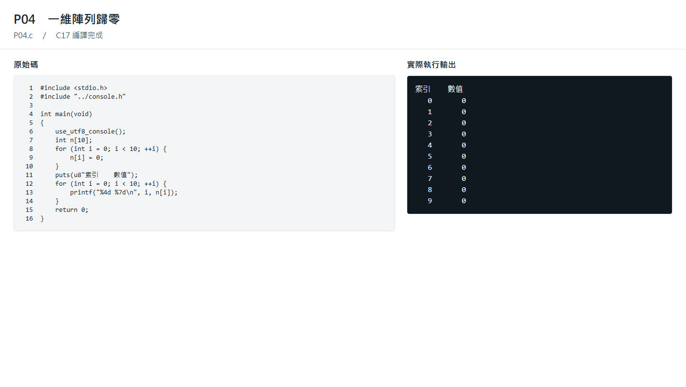

## [P05 陣列初始值](P05/P05.c)

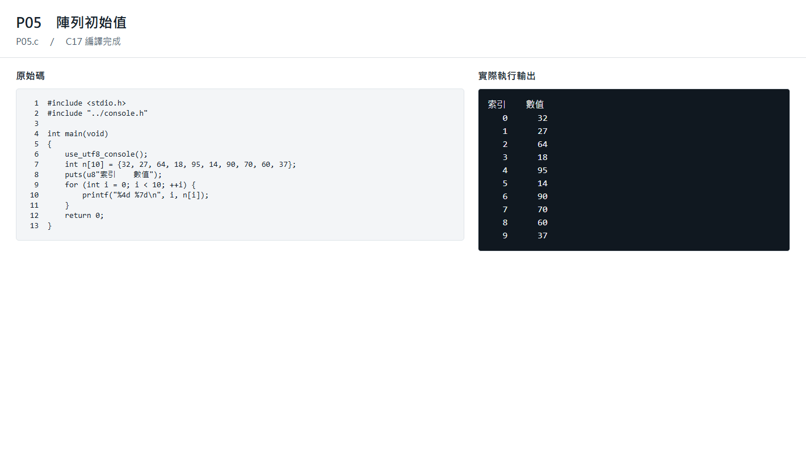

## [P06 使用 SIZE 定義陣列大小](P06/P06.c)


## [P07 陣列元素總和](P07/P07.c)

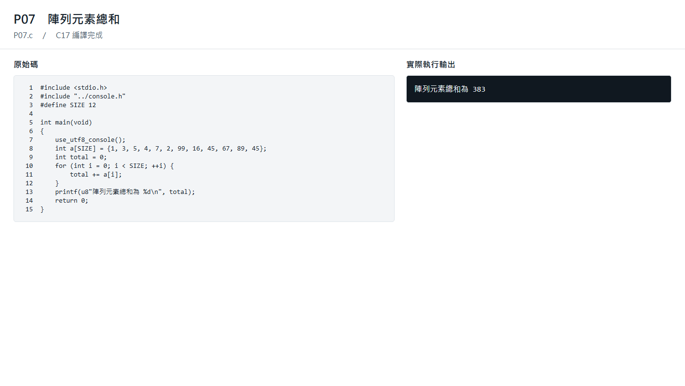

## [P08 星號長條圖](P08/P08.c)

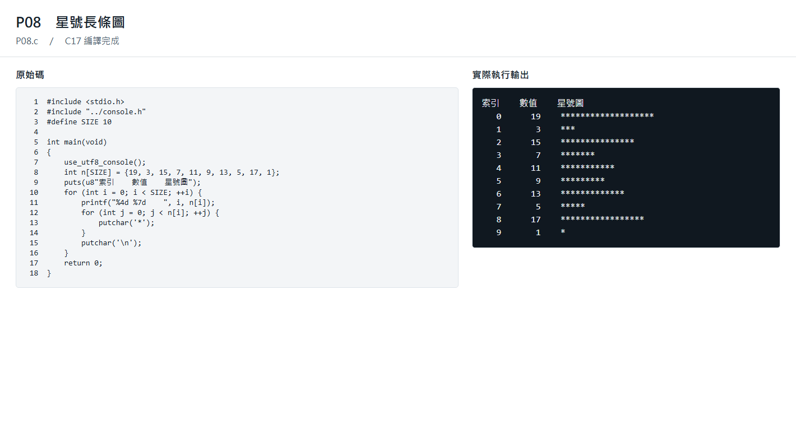

## [P13 二維陣列初始化](P13/P13.c)

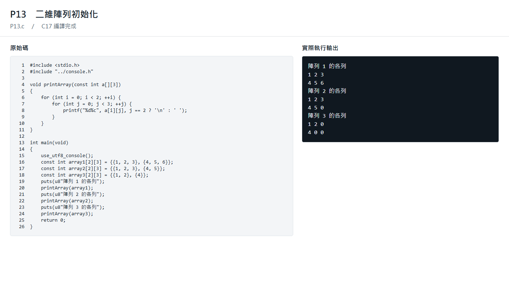

## [P14 學生成績分析](P14/P14.c)

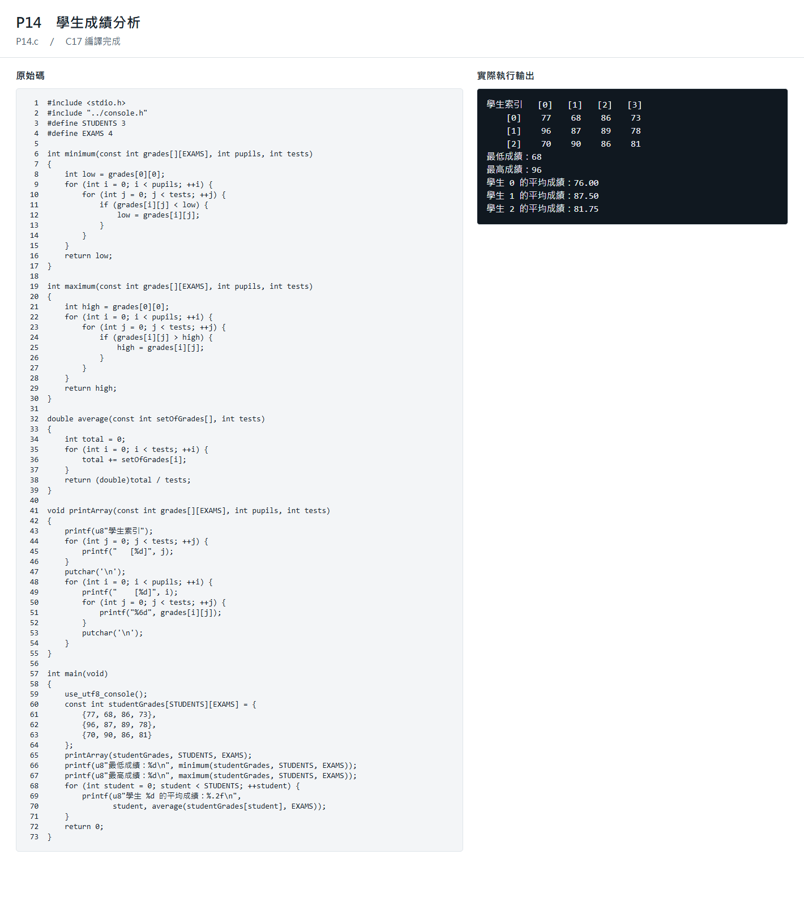

## [P19 字串陣列](P19/P19.c)

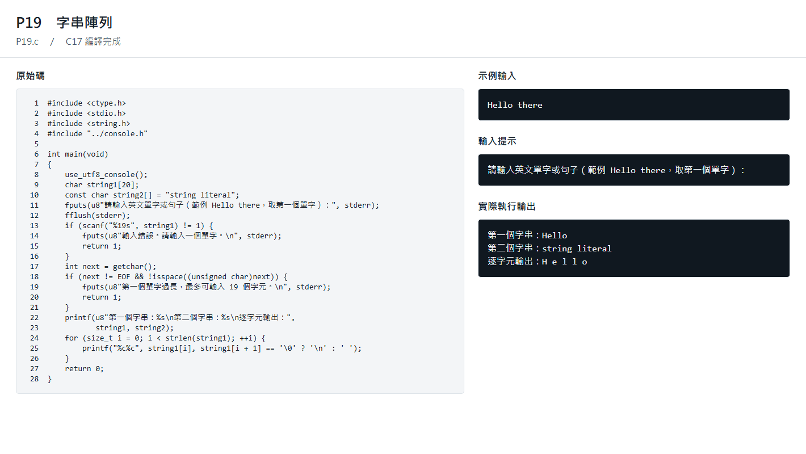

## [P21 靜態陣列與自動陣列](P21/P21.c)

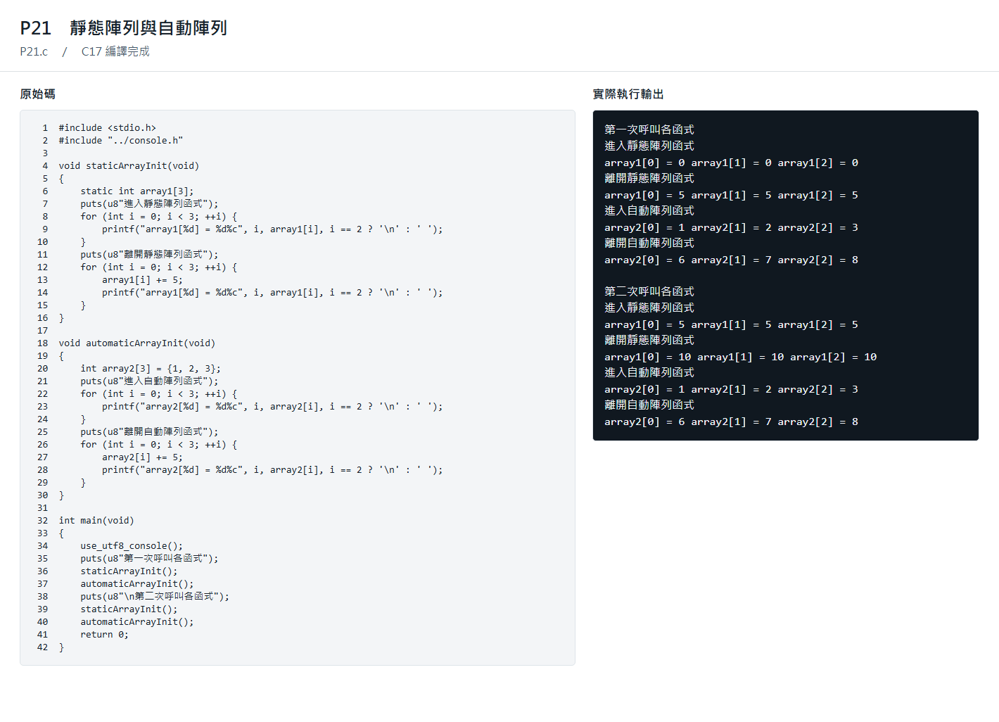

## [P25 C++ 參考參數](P25/P25.cpp)

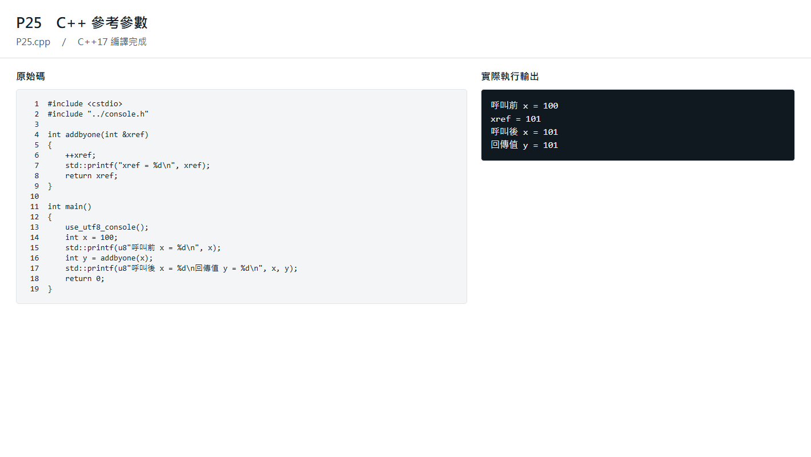

## [P26 陣列位址](P26/P26.c)

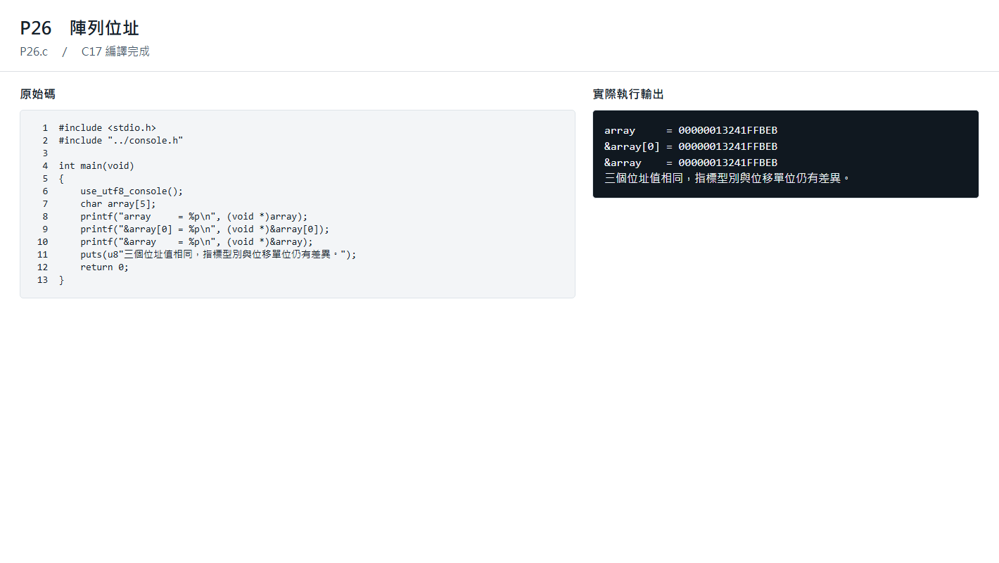

## [P28 陣列與元素傳遞](P28/P28.c)

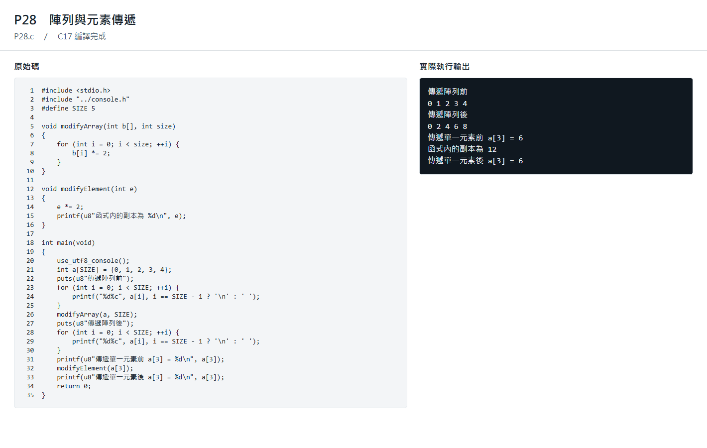

## [P30 反轉陣列](P30/P30.c)

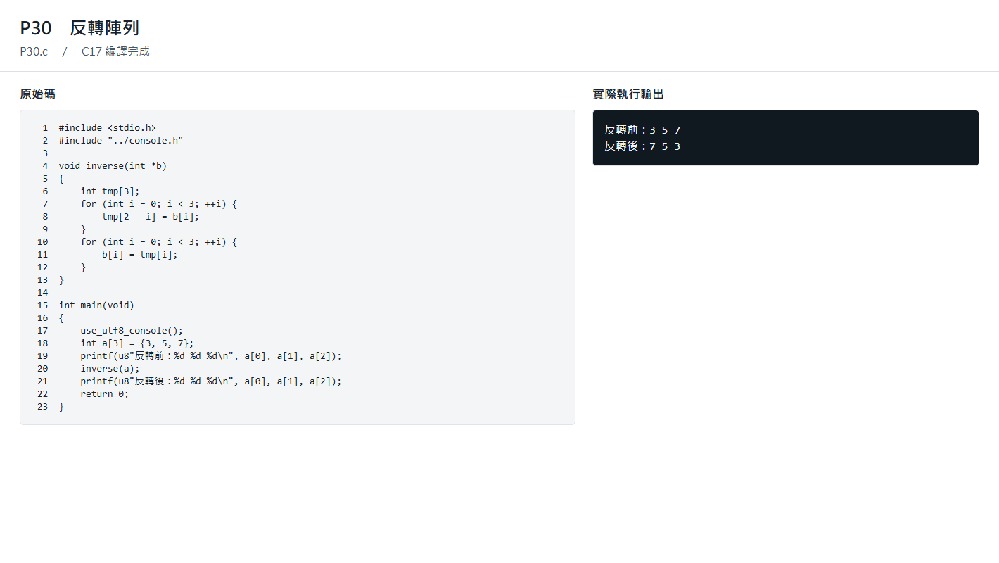

## [P37 線性搜尋](P37/P37.c)

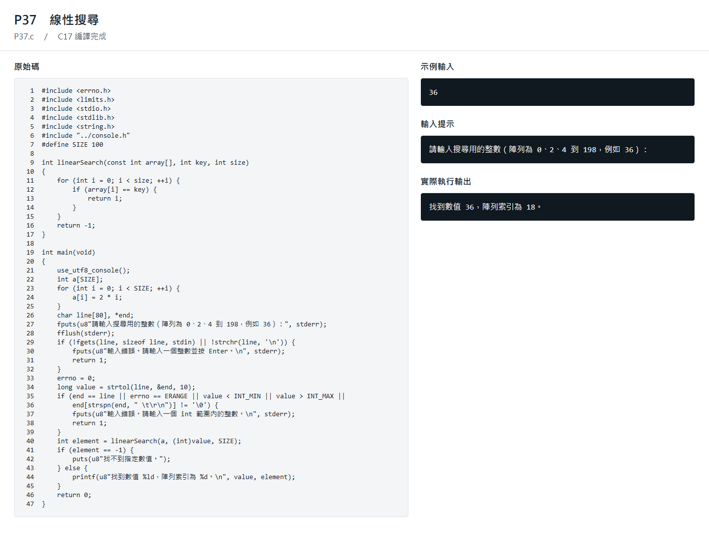

## [6.11 改良氣泡排序](6.11/6.11.c)

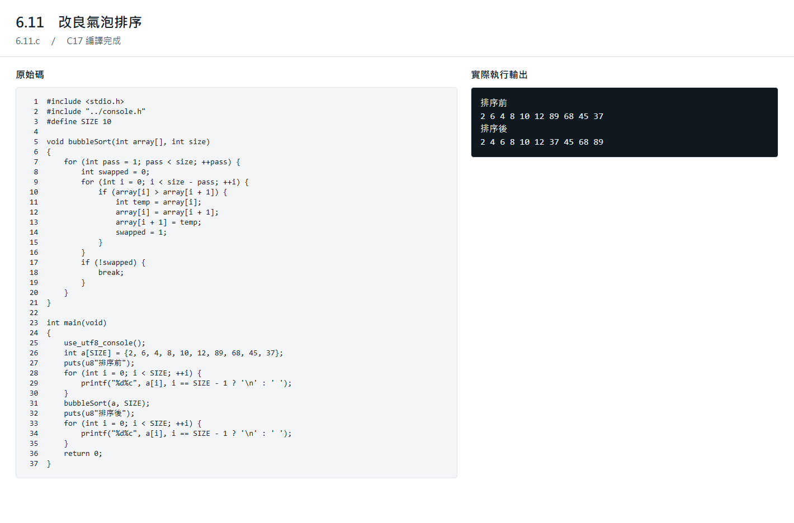
